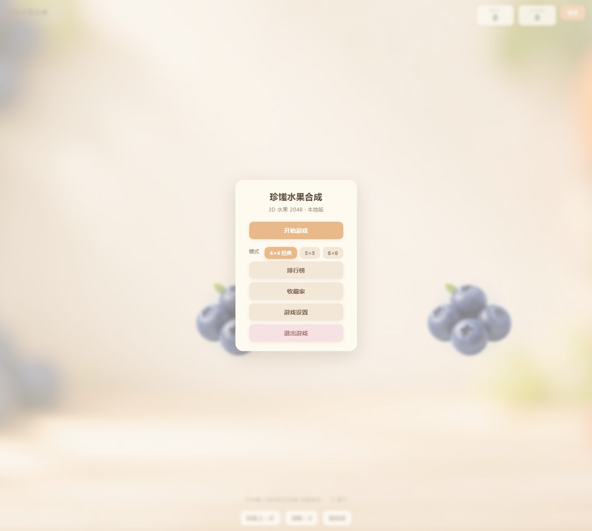
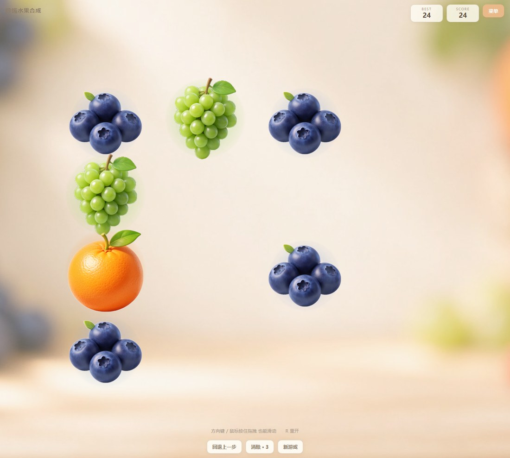
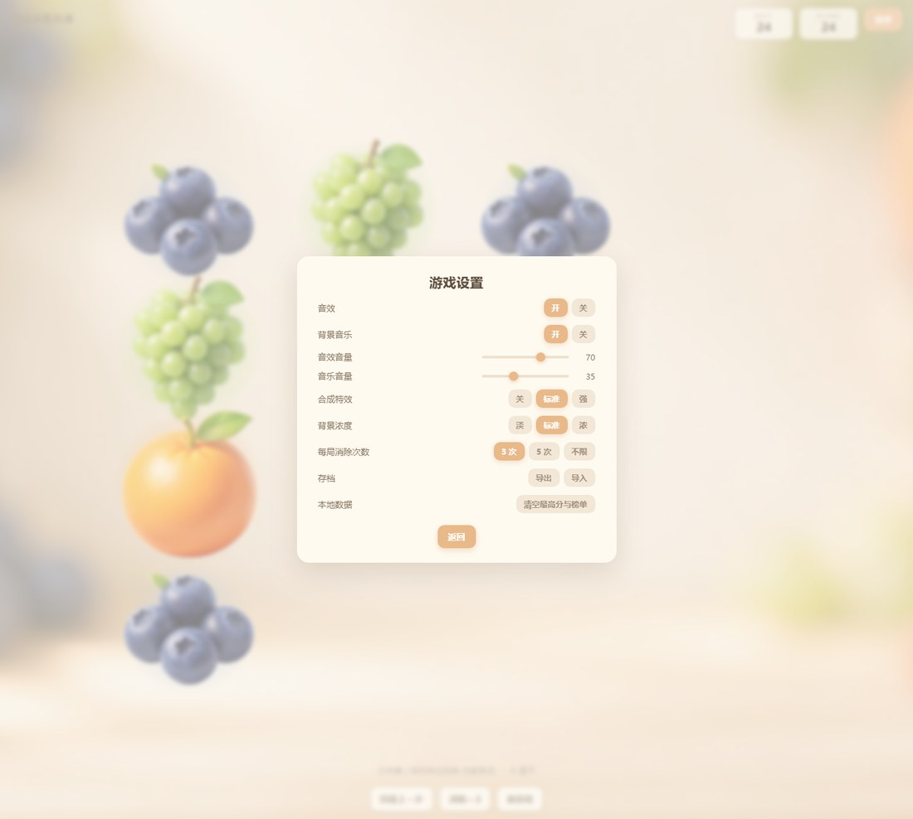

# 珍馐水果合成 2048

一个把 2048 换成果盘的三维小游戏：合的不是数字，是水果。蓝莓合成青提，青提合成橙子，一路合到金色的西瓜。棋盘、水果和背景都是实时 3D 渲染，带品质光晕、合成特效和一套完全内嵌的音效与背景音乐，断网也能玩。

界面与玩法全部重做，规则内核沿用 [Gabriele Cirulli 的 2048](https://github.com/gabrielecirulli/2048)。

<p>
  
  
  
</p>

## 玩法

棋盘上滑动整行或整列，两个同级水果撞在一起就合成高一级的水果，每次滑动会补一个新水果。合成到 2048 级的金西瓜是本局胜利。

| 操作 | 说明 |
|---|---|
| 方向键 | 上下左右滑动 |
| 鼠标 / 手指拖拽 | 朝拖拽方向滑动 |
| R | 直接重开一局 |

## 十一级果盘

| 等级 | 水果 | 等级 | 水果 |
|---|---|---|---|
| 2 | 蓝莓 | 128 | 哈密瓜 |
| 4 | 青提 | 256 | 金果（黄心猕猴桃） |
| 8 | 橙子 | 512 | 草莓 |
| 16 | 桃子 | 1024 | 火龙果 |
| 32 | 菠萝 | 2048 | 金西瓜 |
| 64 | 椰子 | | |

同一级水果按数值高低配不同颜色的品质光晕，一眼能看出盘面上的等级分布。每合成出一个新的最高等级水果，收藏册里对应的一格会点亮，集满 11 格即全收藏。

## 三种模式

主菜单里可选 4×4 经典、5×5、6×6。三种尺寸的最高分和排行榜分开记账，互不干扰。

## 功能

- **三维棋盘**：Three.js 实时渲染，棋盘尺寸随模式变化，摄像机自动适配视距；水果是带透明通道的贴图，合成时有弹跳与缩放动画。
- **消除一格**：每局有固定次数的「消除」额度，默认 3 次，可设成 5 次或不限。点棋盘上任意一格把该水果直接清掉，配合「回退上一步」用来救局。
- **回退上一步**：撤销最近一次滑动。
- **音效与背景音乐**：两路独立通道，各带开关和独立音量滑杆。音效 9 组，背景音乐为内嵌音频数据，不请求任何外部文件。
- **合成特效与背景浓度**：特效三档（关 / 标准 / 强），背景浓度三档（淡 / 标准 / 浓），低配机器可以调轻。
- **存档导出与备份**：把全部本地数据（三档最高分、排行榜、收藏进度、全部对局记录、设置项）导出成一个 JSON 文件；换设备时导入该文件即可恢复，导入只增不覆盖，不会抹掉已有的更高成绩。
- **完全离线**：所有素材、字体、音频都打包在本地，运行时不发任何网络请求。Android 安装包甚至没有申请网络权限。

## 运行

网页版不需要任何构建步骤，起一个本地静态服务即可：

```powershell
cd D:\fylcode\DigitalHuman\小游戏2048
python -m http.server 8080
```

然后浏览器打开 `http://localhost:8080/local/index3d.html`。

也可以直接双击 `local\index3d.html`，但部分浏览器在 `file://` 下会限制本地存储，存档可能丢失，建议用上面的方式起服务。

## 安装包

| 平台 | 产物 | 体积 | 位置 |
|---|---|---|---|
| Windows | NSIS 安装包，装完约 238 MB | 112.6 MB | `build\dist\Fruit2048-Setup-1.0.0.exe` |
| Android | 最小 WebView 壳 APK，minSdk 24 / targetSdk 34 | 2.33 MB | `build\dist\Fruit2048.apk` |

Windows 端用 Electron + electron-builder 打包；Android 端没有用 Gradle，走的是 `aapt2 → javac → d8 → zipalign → apksigner` 的手工流水线，一条命令可重建：

```powershell
pwsh -File "build\android\build-apk.ps1"
```

两个包的构建细节、签名口令、版本号修改方式和踩过的坑，都记在 [build/dist/README.md](build/dist/README.md)。

## 目录结构

```
local/           网页版入口 index3d.html、2D 版 index.html 与 js/ 运行时
  js/            three.min.js、水果与背景数据、3D 渲染器、音效、存档、游戏逻辑
assets/fruits/   11 级水果的透明 PNG 原图
build/desktop/   Electron 主进程与打包配置
build/android/   Android 壳工程、Java 源码与一键打包脚本
tools/           回归测试脚本与音频数据生成脚本
minigame/        原生小游戏工程（Canvas 渲染分支）
```

主要模块：`game_manager.js` 管棋局与模式切换，`renderer3d.js` 管三维渲染与界面交互，`storage_manager.js` 管分档成绩与导入导出，`sfx.js` 管音效与背景音乐。

## 回归测试

```powershell
node tools\test_undo_erase.js
node tools\test_minigame_logic.js
```

两组共 67 项断言，覆盖滑动合并、回退、消除额度与存档读写。

## 许可

代码沿用上游 2048 的 MIT 许可，原始版权声明保留在 [LICENSE.txt](LICENSE.txt)。本项目新增的水果美术、背景图、音效与背景音乐均为自制素材。界面字体沿用上游仓库自带的 Clear Sans，原仓库未附独立的字体许可文件，本项目未改变其许可状态。

## 致谢

规则内核来自 [Gabriele Cirulli](https://github.com/gabrielecirulli/2048) 的 2048，2048 又源自 [Saming 的版本](http://saming.fr/p/2048/)、[1024](https://play.google.com/store/apps/details?id=com.veewo.a1024) 与 [Threes](https://asherv.com/threes/)。三维渲染使用 [Three.js](https://threejs.org/)。
